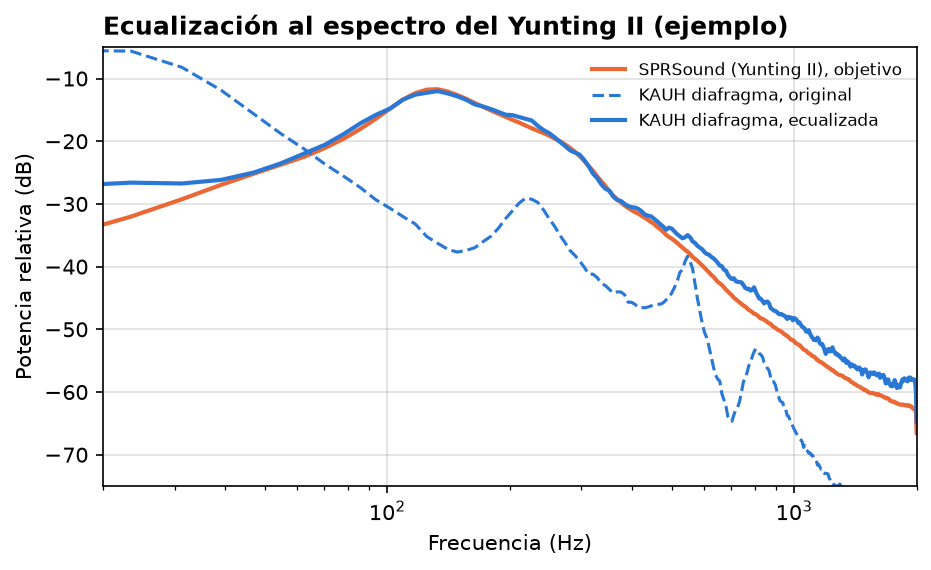
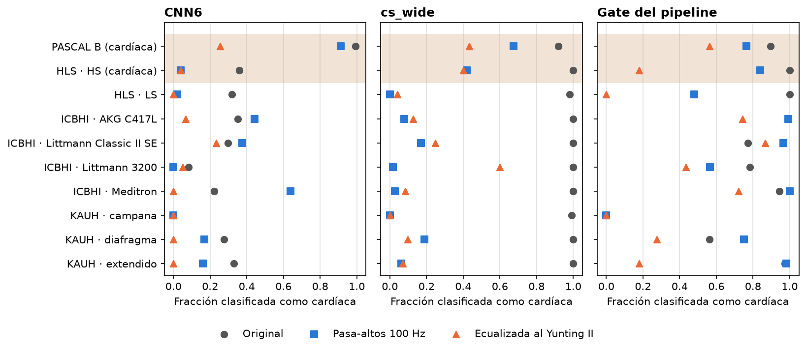
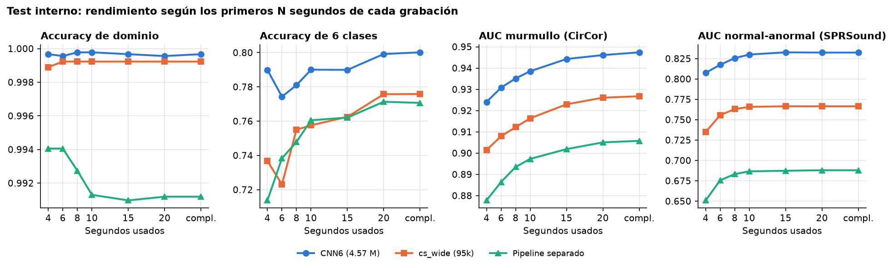
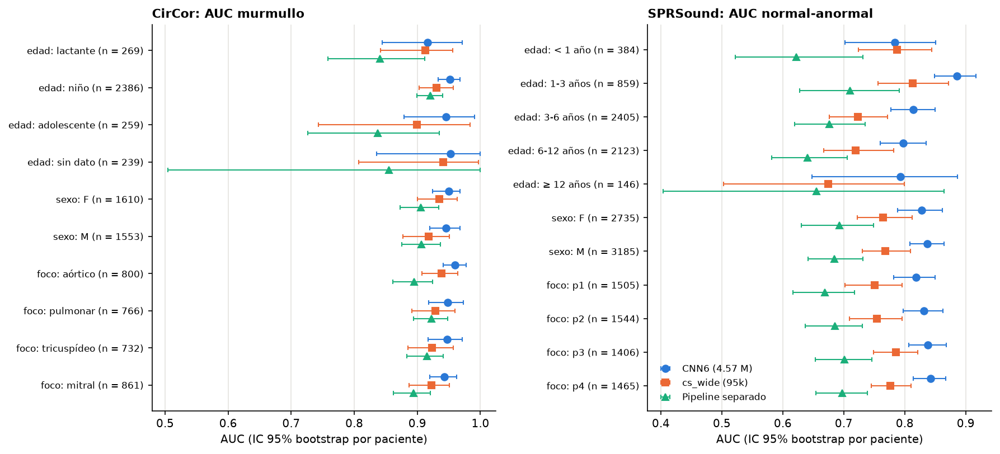

# Análisis complementarios del modelo sin gate

Continúa `avances/28`. Con la validación externa cerrada, se hicieron tres
análisis que no requieren reentrenar y se definió cómo usar el modelo
cuando el operador indica el dominio. Modelos: `cnn6_ours64` (CNN6),
`cs_wide` y, como referencia, el pipeline separado (gate `kfold_cs` →
`abl_card` + `spr_inv`). Fecha: 2026-11-15.

Resumen:

- **Prueba causal del estetoscopio (§1)**: ecualizar el audio externo al
  espectro del Yunting II, sin tocar los modelos, cambia la decisión de
  dominio casi por completo. Las pulmonares externas pasan a pulmonar
  (CNN6: entre 0% y 23% a cardíaco; `cs_wide`: de 100% a entre 0% y 60%) y
  también las cardíacas de PASCAL B (CNN6: de 99% a 25% a cardíaco). La
  firma espectral del equipo **causa** la decisión de dominio, no solo se
  asocia con ella. Las tareas no se rompen: el AUC normal-anormal en
  ICBHI sube de 0.60 a 0.65 con la CNN6.
- **Duración (§2)**: la CNN6 pierde poco con grabaciones cortas (con 4 s,
  AUC de murmullo 0.924 contra 0.947 con la grabación completa, y
  normal-anormal pulmonar 0.808 contra 0.832). Lo pulmonar se estabiliza
  hacia los 10 s; lo cardíaco sigue mejorando hasta 15-20 s.
- **Subgrupos (§3)**: sin diferencias por sexo ni por foco. El grupo más
  difícil son los menores de 1 año, en los dos dominios, por especificidad.
- **Dominio indicado por el operador (§4)**: no requiere una entrada
  nueva. Se restringe la salida de 6 clases al dominio indicado y se
  renormaliza, que es la variante condicional ya evaluada en `avances/28`.

## 1. Prueba causal de la hipótesis del estetoscopio

### 1.1 Qué se probó

`avances/28` §10 mostró que el Yunting II (SPRSound) corta debajo de
~100 Hz y tiene un pico cerca de 130 Hz, mientras que el resto de los
equipos concentra la energía debajo de 100 Hz, y que una regla lineal
sobre 9 rasgos espectrales reproduce las decisiones de dominio de los
modelos. Eso es una asociación. Para probar causalidad se modifica solo
el espectro del audio y se mira si la decisión se mueve, con los mismos
modelos, ventanas y umbrales.

Transformaciones (sobre las cachés de 4 kHz, renormalizando a RMS 0.1):

| Transformación | Qué hace | A qué bases |
|---|---|---|
| `hp100` | Pasa-altos Butterworth de orden 4 a 100 Hz, fase cero | ICBHI, KAUH, HLS (HS y LS), PASCAL B |
| `eq_spr` | Ecualización del espectro mediano de cada grupo (base y equipo o modo) al de SPRSound, con FIR de fase lineal de 1025 coeficientes, ganancia suavizada y limitada a ±40 dB | ídem |
| `eq_akg` | Sentido inverso: test de SPRSound ecualizado al espectro de ICBHI AKG C417L; cada fold predice solo sus pacientes de test | SPRSound |

Predicciones si la hipótesis es cierta: con `eq_spr` todo pasa a
pulmonar, incluidas las cardíacas; con `eq_akg`, SPRSound pasa a
cardíaco.



### 1.2 Resultados de dominio

Fracción de grabaciones mandada a cardíaco (ensamble), original →
`hp100` / `eq_spr`:

| Grupo | n | CNN6 | `cs_wide` | Gate del pipeline |
|---|---|---|---|---|
| PASCAL B (cardíaca) | 461 | 0.99 → 0.91 / **0.25** | 0.92 → 0.68 / **0.43** | 0.90 → 0.76 / **0.56** |
| HLS · HS (cardíaca) | 50 | 0.36 → 0.04 / 0.04 | 1.00 → 0.42 / 0.40 | 1.00 → 0.84 / 0.18 |
| HLS · LS | 50 | 0.32 → 0.02 / 0.00 | 0.98 → 0.00 / 0.04 | 1.00 → 0.48 / 0.00 |
| ICBHI · AKG C417L | 683 | 0.35 → 0.44 / 0.07 | 1.00 → 0.08 / 0.13 | 0.99 → 0.99 / 0.74 |
| ICBHI · Littmann Classic II SE | 141 | 0.30 → 0.38 / 0.23 | 1.00 → 0.17 / 0.25 | 0.77 → 0.97 / 0.87 |
| ICBHI · Littmann 3200 | 60 | 0.08 → 0.00 / 0.05 | 1.00 → 0.02 / 0.60 | 0.78 → 0.57 / 0.43 |
| ICBHI · Meditron | 36 | 0.22 → 0.64 / 0.00 | 1.00 → 0.03 / 0.08 | 0.94 → 1.00 / 0.72 |
| KAUH · campana | 112 | 0.00 → 0.00 / 0.00 | 0.99 → 0.00 / 0.00 | 0.00 → 0.00 / 0.00 |
| KAUH · diafragma | 112 | 0.28 → 0.17 / 0.00 | 1.00 → 0.19 / 0.10 | 0.56 → 0.75 / 0.28 |
| KAUH · extendido | 112 | 0.33 → 0.16 / 0.00 | 1.00 → 0.06 / 0.07 | 0.97 → 0.98 / 0.18 |



Lectura:

- **`eq_spr` confirma la hipótesis en los tres modelos.** Con la CNN6,
  todas las pulmonares externas quedan con 23% o menos a cardíaco (ocho
  de diez grupos por debajo de 7%), y las cardíacas de PASCAL B caen de
  99% a 25%, aunque el sonido sigue siendo cardíaco. Darle al audio la
  "forma" del Yunting alcanza para que el modelo lo trate como pulmonar.
- **En `cs_wide` alcanza con sacar los graves.** Con `hp100` las
  pulmonares externas pasan de ~100% a menos de 20% a cardíaco. Su
  regla de dominio es casi "hay energía debajo de 100 Hz ⇒ cardíaco".
- **La CNN6 mira algo más que los graves.** Con `hp100` algunos grupos
  mejoran (KAUH, HLS, Littmann 3200) y otros empeoran (Meditron de 22% a
  64%, AKG de 35% a 44%). Lo que la mueve de forma consistente es la
  envolvente completa (el pico en ~130 Hz y la caída posterior), no solo
  el corte.
- **El gate reacciona distinto al pasa-altos**: con `hp100` manda más a
  cardíaco en ICBHI y KAUH. Con `eq_spr` sí baja, aunque menos que los
  modelos de 6 clases en ICBHI.

Sentido inverso (`eq_akg`, test de SPRSound con el espectro de AKG
C417L; originalmente ~0% a cardíaco): `cs_wide` manda 45% a cardíaco, el
gate 7% y la CNN6 0.1%. El efecto existe pero es parcial: `cs_wide`
depende sobre todo del espectro, mientras que la CNN6 reconoce el
contenido de SPRSound aun sin la firma del equipo. La firma espectral es
suficiente para llevar algo a pulmonar, pero sacarla no basta para
llevar SPRSound a cardíaco en la CNN6.

### 1.3 Las tareas no se destruyen

AUC normal-anormal condicional en las pulmonares externas (ensamble):

| Base | Modelo | Original | `hp100` | `eq_spr` |
|---|---|---|---|---|
| ICBHI | CNN6 | 0.602 | 0.634 | 0.649 |
| ICBHI | `cs_wide` | 0.522 | 0.571 | 0.578 |
| KAUH | CNN6 | 0.857 | 0.867 | 0.865 |
| KAUH | `cs_wide` | 0.809 | 0.824 | 0.825 |

La ecualización no solo conserva la información clínica: la mejora
levemente, más en ICBHI (+0.05), donde el equipo está más lejos del de
entrenamiento. Esto descarta que el cambio de dominio de §1.2 se deba a
que el filtro "rompe" el audio.

### 1.4 Consecuencias

- La limitación de dominio de `avances/28` queda explicada con evidencia
  causal: el modelo usa la respuesta en frecuencia del estetoscopio como
  atajo para decidir el dominio, porque en el entrenamiento cada dominio
  vino de un solo equipo.
- Ecualizar al Yunting **no sirve como corrección general**: también
  manda a pulmonar las cardíacas. Solo tiene sentido si el dominio ya se
  conoce (§4), y ahí aporta una mejora chica en la tarea pulmonar.
- La corrección de fondo es la augmentation de equipo (`avances/28`
  §13, opción (a)), que queda como trabajo futuro. Este resultado indica
  qué tiene que aleatorizar: la envolvente entre 50 y 300 Hz, no solo el
  corte de graves.

## 2. Rendimiento según la duración de la grabación

Test interno (CirCor y SPRSound, folds de test, 9083 grabaciones), usando
solo las ventanas de los primeros N segundos. Umbrales y regla congelados
de la validación interna.

| Duración | CNN6 murmullo AUC | CNN6 N-A pulm. AUC | CNN6 acc. 6 clases | `cs_wide` murmullo | `cs_wide` N-A pulm. | Pipeline murmullo | Pipeline N-A pulm. |
|---|---|---|---|---|---|---|---|
| 4 s | 0.924 | 0.808 | 0.790 | 0.901 | 0.735 | 0.878 | 0.651 |
| 6 s | 0.931 | 0.817 | 0.774 | 0.908 | 0.756 | 0.886 | 0.676 |
| 8 s | 0.935 | 0.826 | 0.781 | 0.912 | 0.763 | 0.893 | 0.683 |
| 10 s | 0.939 | 0.830 | 0.790 | 0.916 | 0.766 | 0.897 | 0.687 |
| 15 s | 0.944 | 0.833 | 0.790 | 0.923 | 0.766 | 0.902 | 0.687 |
| 20 s | 0.946 | 0.832 | 0.799 | 0.926 | 0.766 | 0.905 | 0.688 |
| Completa | 0.947 | 0.832 | 0.800 | 0.927 | 0.766 | 0.906 | 0.688 |



- **Pulmonar**: se estabiliza a los 10 s en los tres sistemas. SPRSound
  tiene grabaciones de 9 a 15 s, así que más allá de 10 s casi no hay
  información nueva.
- **Cardíaco**: el AUC de murmullo sigue subiendo hasta 15-20 s
  (+0.02 entre 4 s y la grabación completa en la CNN6).
- **La CNN6 es la que menos depende de la duración**: con una sola
  ventana de 4 s pierde 0.02 de AUC en cada tarea. `cs_wide` pierde 0.03
  y el pipeline 0.03-0.04.
- La accuracy de 6 clases baja a 6 s y vuelve a subir. No es un efecto
  real de la duración: con la regla `frac` y pocas ventanas, la fracción
  de ventanas positivas toma pocos valores y el umbral fijo corta
  distinto.
- La accuracy de dominio no cambia con la duración (≥0.99 en todos los
  casos).

Recomendación de uso: **al menos 10 s por foco pulmonar y 15-20 s por
foco cardíaco**. Con 4 s el sistema funciona, con una pérdida chica.

## 3. Subgrupos del test interno

Grabación completa, IC 95% por bootstrap de pacientes (1000 réplicas).



### 3.1 CirCor (murmullo)

| Subgrupo | n | Murmullos | CNN6 AUC [IC 95%] | CNN6 acc. 6 clases |
|---|---|---|---|---|
| Lactante | 269 | 49 | 0.916 [0.844, 0.971] | 0.799 |
| Niño | 2386 | 389 | 0.952 [0.933, 0.968] | 0.930 |
| Adolescente | 259 | 46 | 0.946 [0.879, 0.991] | 0.946 |
| Sexo F / M | 1610 / 1553 | 249 / 250 | 0.950 / 0.945 | 0.916 / 0.929 |
| Foco aórtico / pulmonar / tricuspídeo / mitral | 800 / 766 / 732 / 861 | 109 / 122 / 126 / 140 | 0.960 / 0.948 / 0.947 / 0.943 | 0.920 / 0.933 / 0.940 / 0.900 |

### 3.2 SPRSound (normal contra anormal)

| Subgrupo | n | Anormales | CNN6 AUC [IC 95%] | CNN6 acc. 6 clases |
|---|---|---|---|---|
| < 1 año | 384 | 207 | 0.784 [0.702, 0.851] | 0.576 |
| 1-3 años | 859 | 422 | 0.886 [0.849, 0.917] | 0.647 |
| 3-6 años | 2405 | 593 | 0.814 [0.777, 0.850] | 0.759 |
| 6-12 años | 2123 | 464 | 0.798 [0.760, 0.835] | 0.764 |
| ≥ 12 años | 146 | 16 | 0.793 [0.648, 0.886] | 0.849 |
| Sexo F / M | 2735 / 3185 | 712 / 990 | 0.828 / 0.837 | 0.739 / 0.731 |
| Foco p1 / p2 / p3 / p4 | 1505 / 1544 / 1406 / 1465 | 401 / 460 / 404 / 437 | 0.818 / 0.832 / 0.838 / 0.842 | 0.741 / 0.725 / 0.741 / 0.734 |

### 3.3 Lectura

- **Sexo y foco**: ninguna diferencia; los intervalos se superponen en
  todos los casos y en los tres sistemas.
- **Menores de 1 año**: el grupo más difícil en los dos dominios. En
  CirCor, la accuracy de 6 clases de los lactantes (0.80 [0.74, 0.86])
  queda separada de la de los niños (0.93 [0.92, 0.94]); el AUC de
  murmullo baja menos (0.92 contra 0.95) y con intervalos superpuestos.
  En SPRSound la accuracy baja a 0.58 contra 0.76 de 6 a 12 años. En
  ambos casos la caída viene de la especificidad (CirCor 0.79 contra
  0.96; SPRSound 0.70 contra 0.84): el modelo marca como anormales más
  sanos de esa edad. Es esperable por la frecuencia cardíaca y
  respiratoria más alta, el llanto y el movimiento.
- En SPRSound la accuracy crece con la edad sobre todo porque baja la
  prevalencia de anormales (54% en menores de 1 año, 11% en mayores de
  12), no porque el ordenamiento mejore: el mejor AUC es el de 1 a 3 años
  (0.886).
- El patrón es el mismo en `cs_wide` y en el pipeline, con valores más
  bajos (tablas en `subgroups.csv`).

Para la memoria: se reporta como limitación de rendimiento en lactantes,
con la sugerencia de calibrar el umbral por grupo de edad si se usa en
neonatología.

## 4. Uso con el dominio indicado por el operador

La CNN6 no tiene una entrada que indique el dominio, y no hace falta
agregarla. Como la salida es una softmax de 6 clases (cardíaco normal y
murmullo; pulmonar normal, crackle, wheeze y ambos), alcanza con
quedarse con las clases del dominio que indica el operador y
renormalizar:

- **Cardíaco**: P(murmullo | cardíaco) = p1 / (p0 + p1).
- **Pulmonar**: P(crackle | pulmonar) = (p3 + p5) / (p2 + p3 + p4 + p5),
  y P(wheeze | pulmonar) = (p4 + p5) / (p2 + p3 + p4 + p5).

Es exactamente la variante condicional de `avances/28` (`--conditional`),
y sus umbrales ya se calibraron así en la validación interna, de modo que
no hay que reentrenar ni recalibrar. Con esto, el error de dominio
desaparece por construcción y quedan las cabezas de tarea, que son las
que generalizan (`avances/28` §6 y §12).

Opcional: comparar el dominio indicado con el que elige el modelo
(p0 + p1 contra 0.5) y mostrar una advertencia si no coinciden. Según §1,
con un equipo distinto de los de entrenamiento esa advertencia aparecería
seguido, así que conviene presentarla como "equipo no reconocido", no
como error del operador.

Este es el modo de uso recomendado para la API o interfaz (sesión
aparte). Si además se sabe que el equipo no es el Yunting II, ecualizar
la grabación pulmonar al espectro de SPRSound (§1.3) agrega una mejora
chica en la tarea pulmonar; queda como opción, no como parte del sistema
validado.

## 5. Comandos

```bash
cd desarrollo/src
python unified_model/device_intervention.py            # inferencia (~2 h en CPU, con cache) y resumen
python unified_model/device_intervention.py --summary  # solo las tablas
python unified_model/device_intervention.py --plot     # solo domain.png
python unified_model/internal_analysis.py              # duración y subgrupos
python unified_model/internal_analysis.py --plot       # solo las figuras
```

Salidas:

- `reports/external_validation/intervention/`: `domain_summary.csv`,
  `domain_summary_long.csv`, `task_auc.csv`, `spectra.png`, `domain.png`,
  `intervention_run.txt` y `window_probs/` (~33 MB).
- `reports/unified_model/internal_analysis/`: `duration.csv`,
  `duration.png`, `subgroups.csv`, `subgroups.png`.

## 6. Pendiente

1. **Memoria**: la prueba causal va en el Cap. 4 junto con la validación
   externa, como explicación de la limitación de dominio. Duración y
   subgrupos, en el mismo capítulo como análisis del test interno.
2. **Trabajo futuro** (no ahora): augmentation de equipo sobre la
   envolvente de 50 a 300 Hz, detección de equipo no reconocido,
   calibración de probabilidades, mapas de activación y latencia.
3. **API o interfaz**: en una sesión separada, con el modo de §4.

## 7. Estado del repositorio

Sin commitear al cerrar, además de lo listado en `avances/28` §14:

- `unified_model/device_intervention.py`;
- `unified_model/internal_analysis.py`;
- `reports/external_validation/intervention/` (`window_probs/` pesa
  ~33 MB; se puede dejar afuera y versionar solo tablas y figuras);
- `reports/unified_model/internal_analysis/`;
- este documento.
